# MaintQA — 선박 정비이력 질의응답 챗봇 (DuckDB + 로컬 LLM) · Colab GPU 실습

- 이름: 박근태
- 학번: 20220281
- 소속: 한국해양대학교 기관시스템공학부

선박 정비이력을 자연어로 질문하면 DuckDB에서 집계하거나 정비 문서를 검색해 **출처와 함께** 답하는 오프라인 챗봇입니다. Colab GPU 실습에서는 이 챗봇의 핵심 과정(질문 → SQL 생성 → DuckDB 실행)을 T4 GPU에서 실행해 정확도와 속도를 평가했습니다.

## 제출 항목 요약

| 요구사항 | 위치 | 상태 |
|---|---|---|
| 1. DuckDB 적용 | `app/`, `app/tests/` | 완료 — 로컬 학생용 300문서 DB 연결, 공개 재현 데이터로 테스트 12개 통과 |
| 3. Colab GPU AI/ML·DL 실습 | `colab/`, `evidence/colab_chatbot/` | 완료 — 챗봇 LLM(gemma4:e2b)을 T4 GPU에서 실행, SQL 정확도 75%(9/12), CPU 대비 약 65배 빠름, 화면 5장 (보조: MNIST CNN 학습) |
| 4. ChatGPT Codex 증빙 | `evidence/codex/` | Codex 대화 화면 5장 |
| 5. 소스코드 공개 | 이 저장소 | Public |

## 1. DuckDB 적용

정비 문서(master), 작업 라인(pms), 선박(vessels) 등을 DuckDB에 적재하고, 웹 서버 프로세스 안에서 **읽기 전용**으로 조회합니다.

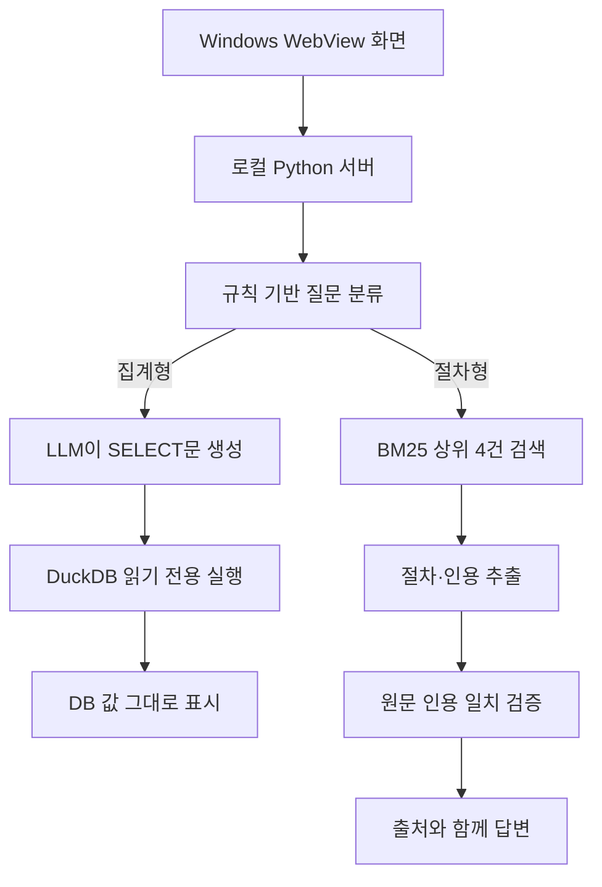

- 집계형 질문(예: "전체 정비 문서 수")은 LLM이 SQL을 만들고 DuckDB 결과를 그대로 보여줍니다.
- 절차형 질문은 관련 문서를 검색해 원문 인용이 실제 문서와 일치할 때만 답변합니다. 근거가 부족하면 답변을 보류합니다.
- 모델 요청은 temperature=0, top_k=1, seed=42로 고정했습니다.
- 로컬 학생용 DB 기준: 테이블 6개, 정비 문서 300건, 테스트 14개 통과(비공개 데이터라 저장소에는 미포함).

### 데이터 공개 범위

수업용으로 제공받은 정비 DB·CSV·XLSX, 개인 PC 설정, 로그, 모델 가중치는 포함하지 않았습니다. 대신 `app/create_public_demo.py`가 **가상 정비 기록 12건**(작업 라인 24건, 선박 6척)을 만들어 누구나 같은 테스트를 재현할 수 있게 했습니다. 실제 정비 판단에는 사용할 수 없습니다.

### 재현 방법 (모델 없이 DuckDB 검사)

Python 3.12 이상:

```bash
python -m venv .venv
# Windows: .venv\Scripts\activate
python -m pip install -r app/requirements.txt
python app/create_public_demo.py
python -m unittest discover -s app/tests -v
```

테스트 항목: 복합키 `(VESSELCODE, DOC_NO)` 처리, 읽기 전용 실행, 외부 파일 접근 차단, 검색·출처 연결, 인용 검증, 취소 기록, 고정 모델 파라미터. 로컬 실행 기록은 `docs/local-validation.txt`에 있습니다.

### 챗봇 실행

1. 위 명령으로 공개 DB를 생성합니다.
2. `app/settings.json`의 `model_path`, `llama_server_path`에 로컬 GGUF 모델과 llama-server 경로를 입력합니다. (모델은 배포하지 않습니다.)
3. `python -m pip install -r app/requirements-webview.txt`
4. `python app/desktop.py`

모델 서버는 `127.0.0.1:50081`, 질의 서버는 `127.0.0.1:8760`을 사용하며, 설치 후에는 인터넷 없이 동작합니다.

## 3. Colab GPU 실습 — 챗봇 LLM을 GPU에서 실행·평가

내 PC에서는 그래픽카드를 쓰지 못해 챗봇의 LLM이 CPU로만 동작했습니다. 그래서 챗봇의 핵심 과정인 **질문 → SQL(DB 조회 명령문) 생성 → DuckDB 실행**을 Colab의 T4 GPU에서 그대로 재현하고, 생성된 SQL이 맞는지와 속도가 얼마나 빨라지는지 확인했습니다.

- 노트북: [`colab/MaintQA_Colab_GPU_SQL.ipynb`](colab/MaintQA_Colab_GPU_SQL.ipynb)
- 환경: Google Colab **Tesla T4 GPU**, Ollama 0.40, DuckDB
- 모델: `gemma4:e2b` (챗봇과 같은 모델), temperature=0·top_k=1·seed=42로 고정
- 프롬프트: 챗봇 소스 `app/engine.py`의 SQL 생성 프롬프트(테이블 구조·규칙·예시 포함)를 그대로 사용
- 데이터: 이 저장소의 공개용 **가상** 정비기록 12건 (수업 제공 DB는 사용·업로드하지 않음)
- 평가 방법: 정비 질문 12개에 대해, 모델이 만든 SQL의 **실행 결과**가 사람이 작성한 정답 SQL의 결과와 같으면 정답

### 결과

| 항목 | 결과 |
|---|---|
| SQL 정확도 | **9/12 (75%)** |
| 질문당 평균 응답 시간 (같은 질문 3개) | GPU **0.2초** / CPU 16.2초 → 약 65배 빠름 |
| 초당 생성 토큰 수 | GPU **93.6개** / CPU 5.2개 |

틀린 3문항은 모두 **조건을 잘못 해석한 경우**였습니다.
- Q05 "훈련용 펌프 문서 수": 펌프 조건 없이 작업 라인 전체(24)를 셈 (정답 6)
- Q06 "훈련용 팬 문서 수": 영어로 저장된 값(`TRAINING FAN`)을 한글 '팬'으로 검색해 0건 (정답 6)
- Q07 "부품 소모 기록이 있는 문서 수": 선박 코드 없이 문서번호만으로 세어 1건 (정답 6)

즉, 숫자를 세는 단순 질문은 잘 맞히지만 **한글 용어 ↔ DB의 영어 값 대응**과 **(선박 코드, 문서번호) 복합키**에서 실수가 나왔습니다. 실제 챗봇에서 용어 대응표(terms.json)와 SQL 실행 전 검사가 필요한 이유를 확인한 결과입니다. CPU 시간에는 모델을 CPU 메모리로 다시 올리는 시간이 일부 포함되어 있어 실제 배율은 이보다 작을 수 있습니다.

| 증빙 | 내용 |
|---|---|
| 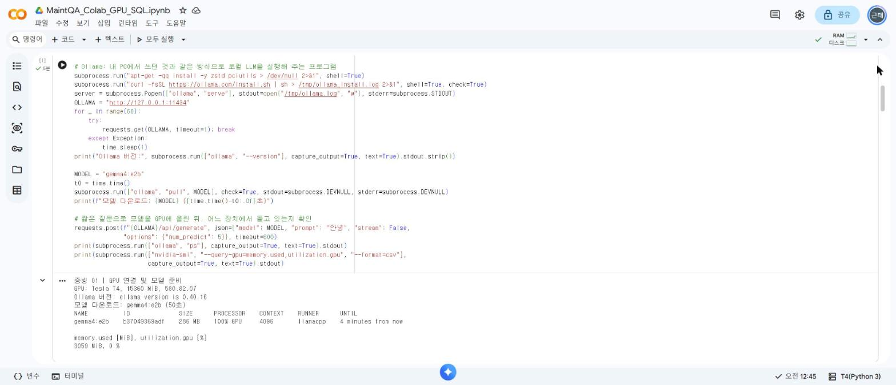 | 01 T4 GPU 확인, Ollama 설치, gemma4:e2b가 GPU 100%로 실행됨 |
| 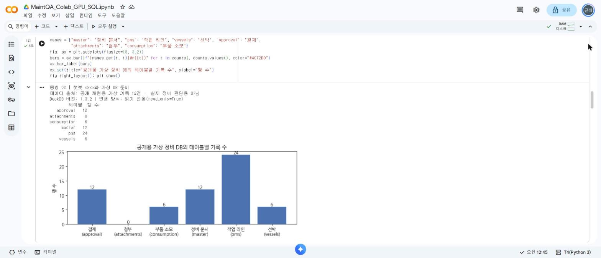 | 02 챗봇 소스와 공개용 가상 DuckDB 준비, 테이블별 기록 수 |
| 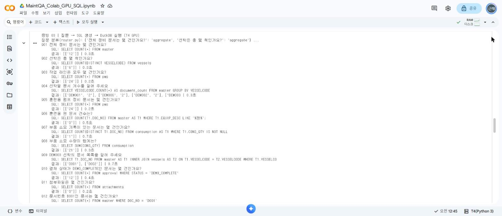 | 03 질문 12개 → SQL 생성 → DuckDB 실행 결과 |
| 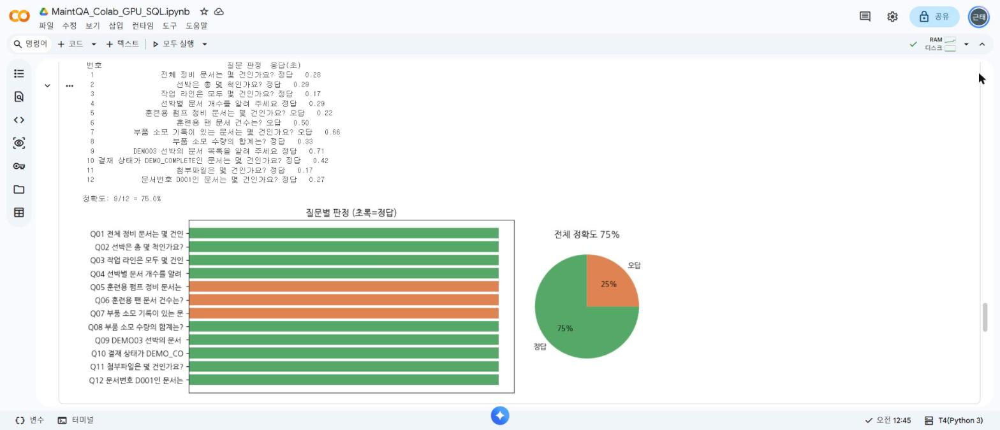 | 04 정답 비교 및 정확도 시각화 (75%) |
| 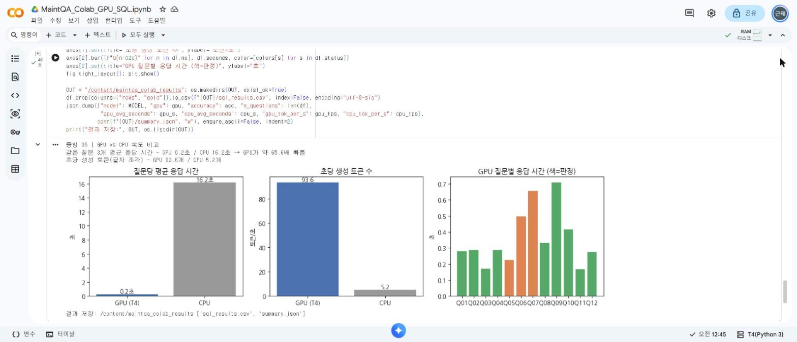 | 05 GPU와 CPU 속도 비교 시각화 |

### 보조 실습 — MNIST 손글씨 숫자 분류 CNN 학습

GPU로 딥러닝 모델을 **직접 학습**시키는 실습도 함께 진행했습니다. (`colab/MaintQA_Colab_GPU_MNIST.ipynb`, `evidence/colab/`)
- Tesla T4에서 소형 CNN을 3 에폭 학습, **테스트 정확도 96.31%** (학습 12,000장 / 검증 3,000장 / 테스트 10,000장)
- 증빙: GPU 확인, 데이터 시각화, 학습 로그, 혼동행렬, 학습 곡선 (`evidence/colab/01~05`)

## 4. ChatGPT Codex 활용

ChatGPT 데스크톱 앱의 Codex로 챗봇 요구사항 정리, Python/HTML 코드 구현, DuckDB 연결·적재 검증, 테스트 작성과 실행, 공개용 소스 정리를 진행했습니다. 대화 화면은 `evidence/codex/`에 있습니다.

| 증빙 | 내용 |
|---|---|
| 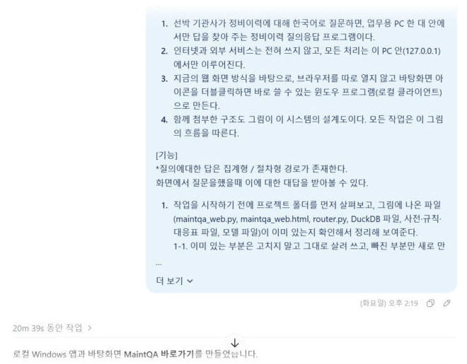 | 01 챗봇 요구사항과 설계 요청 |
| 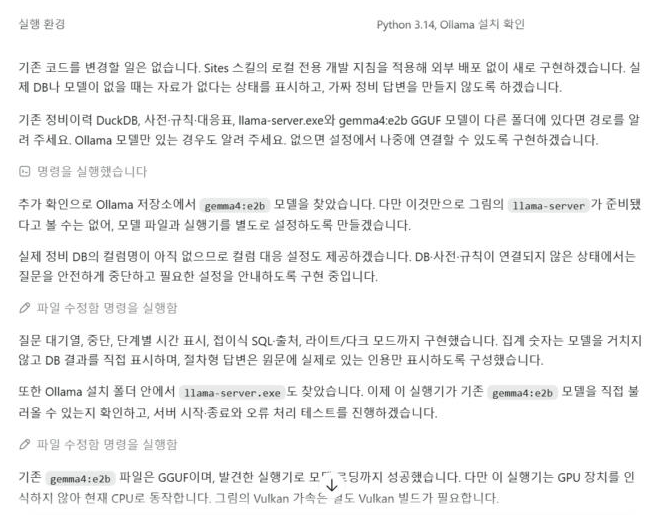 | 02 코드 구현 및 파일 수정 |
| 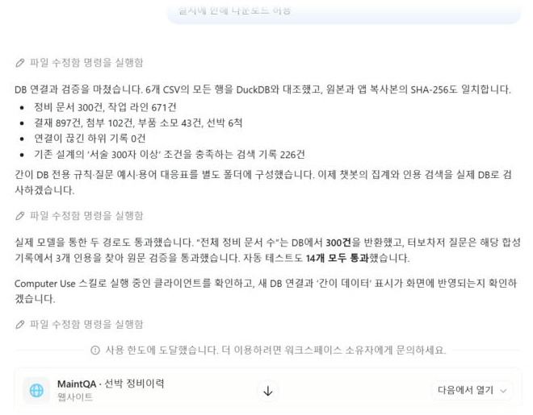 | 03 DuckDB 연결·적재 검증 (정비 문서 300건, 6개 테이블) |
| 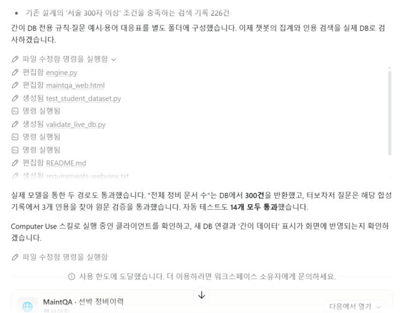 | 04 테스트 작성·실행 (14개 통과) |
| 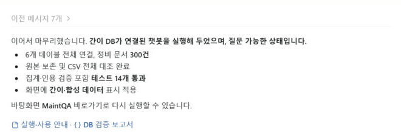 | 05 완성된 앱과 최종 결과 |

## 폴더 구조

```
app/              챗봇 소스 (DuckDB, 검색, 모델 연결, 웹 화면)
app/tests/        자동 테스트
colab/            Colab GPU 실습 노트북 (챗봇 SQL 실습, MNIST 보조 실습)
docs/             증빙 촬영 기준, 로컬 테스트 기록
evidence/colab_chatbot/  챗봇 연계 Colab 실행 화면 5장
evidence/colab/   MNIST 보조 실습 화면 5장
evidence/codex/   Codex 대화 화면 5장
```


## 논문용 실제 앱 화면

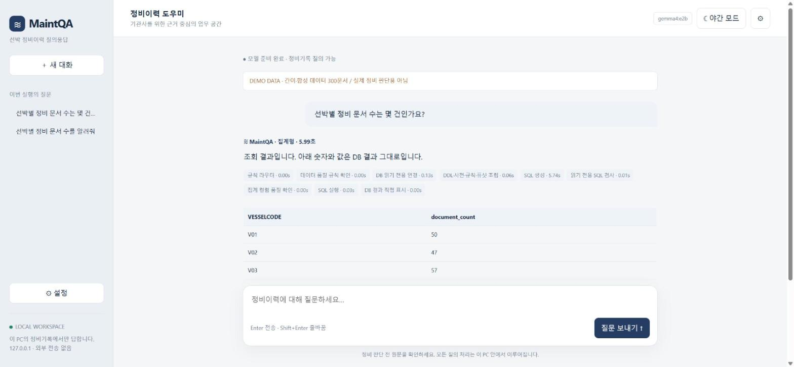

로컬 PC에서 MaintQA(gemma4:e2b)를 실행해 "선박별 정비 문서 수는 몇 건인가요?"를 질문한 화면입니다. 질문 분류(집계형) → SQL 생성 → 읽기 전용 SQL 검사 → DuckDB 실행 → 결과 표 순서로 처리되었고, 응답 시간은 5.99초입니다. 화면의 데이터는 간이·합성 데이터 300문서(DEMO DATA)로, 실제 정비 판단용이 아닙니다.

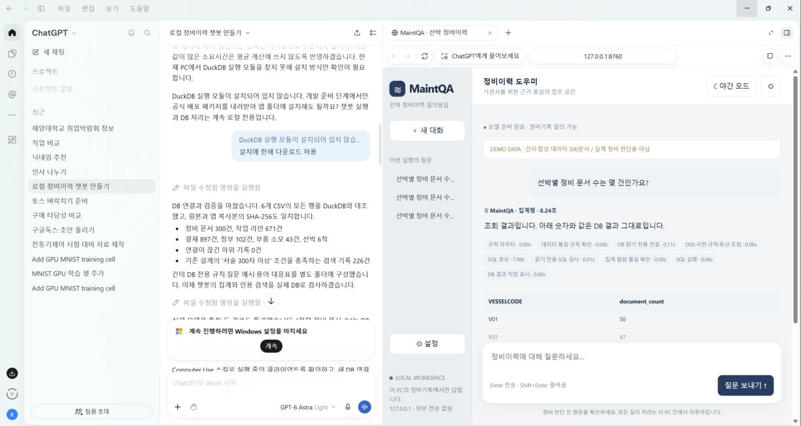

ChatGPT 데스크톱 앱의 Codex(Work) 대화(왼쪽)와, Codex 내장 브라우저로 연 MaintQA 페이지(오른쪽)를 함께 캡처한 화면입니다. 왼쪽에는 Codex가 DuckDB 연결·검증(정비 문서 300건, 작업 라인 671건)과 자동 테스트 14개 통과를 보고한 내용이, 오른쪽에는 같은 질문의 집계 결과(응답 8.24초)가 보입니다.
