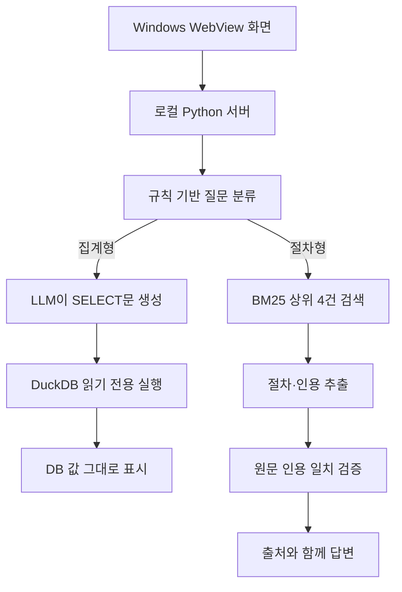
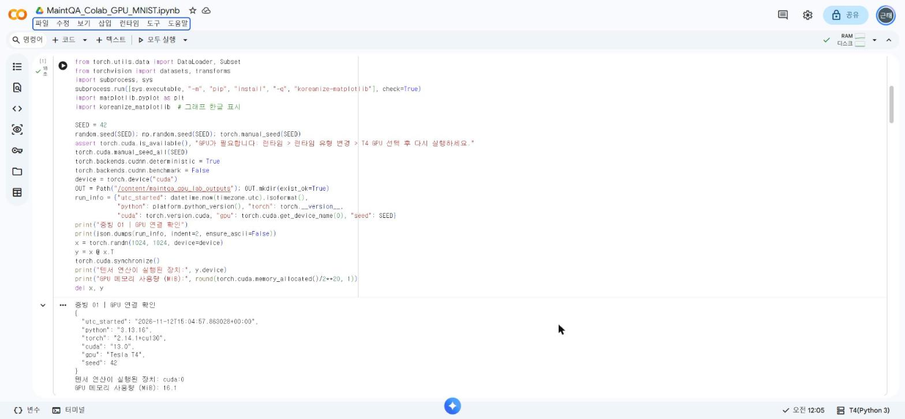
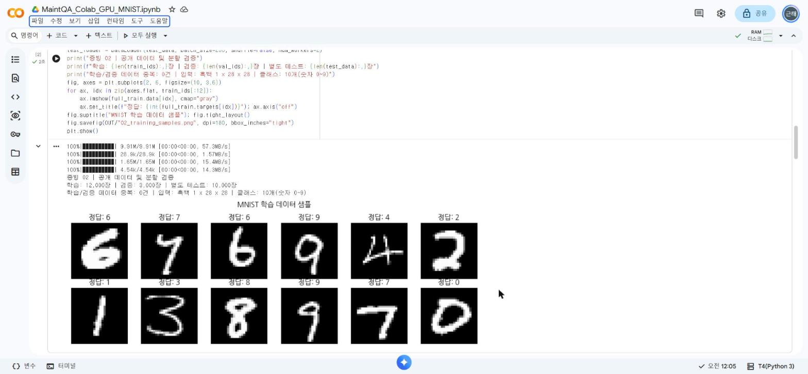
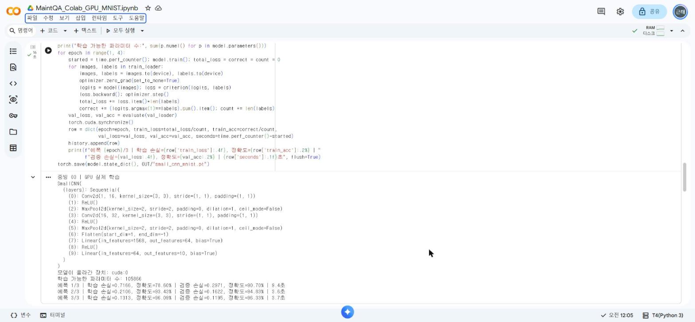
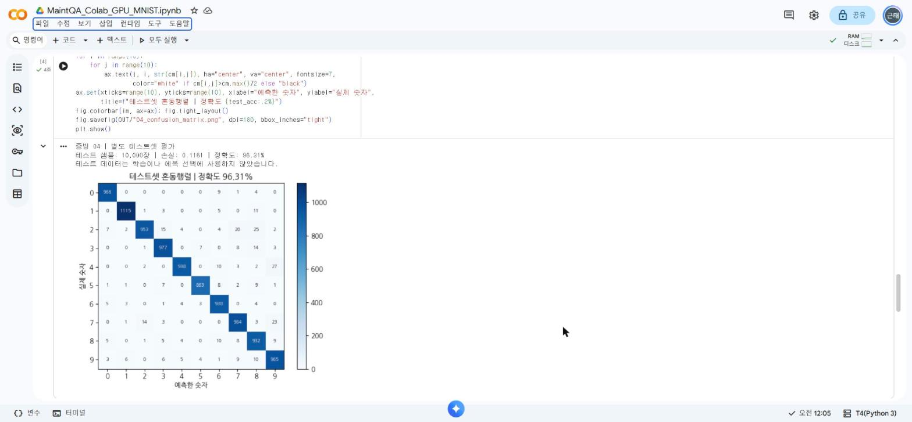
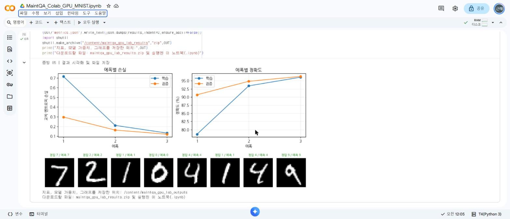

# MaintQA — 선박 정비이력 질의응답 챗봇 (DuckDB + 로컬 LLM) · Colab GPU 실습

- 이름: 박근태
- 학번: 20220281
- 소속: 한국해양대학교 기관시스템공학부

선박 정비이력을 자연어로 질문하면 DuckDB에서 집계하거나 정비 문서를 검색해 **출처와 함께** 답하는 오프라인 챗봇입니다. Colab GPU 실습은 이와 별도로 진행했습니다.

## 제출 항목 요약

| 요구사항 | 위치 | 상태 |
|---|---|---|
| 1. DuckDB 적용 | `app/`, `app/tests/` | 완료 — 로컬 학생용 300문서 DB 연결, 공개 재현 데이터로 테스트 12개 통과 |
| 3. Colab GPU AI/ML·DL 실습 | `colab/`, `evidence/colab/` | 완료 — Tesla T4에서 CNN 학습, 테스트 정확도 96.31%, 화면 5장 |
| 4. ChatGPT Codex 증빙 | `evidence/codex/` | Codex 대화 화면 5장 |
| 5. 소스코드 공개 | 이 저장소 | Public |

## 1. DuckDB 적용

정비 문서(master), 작업 라인(pms), 선박(vessels) 등을 DuckDB에 적재하고, 웹 서버 프로세스 안에서 **읽기 전용**으로 조회합니다.



- 집계형 질문(예: "전체 정비 문서 수")은 LLM이 SQL을 만들고 DuckDB 결과를 그대로 보여줍니다.
- 절차형 질문은 관련 문서를 검색해 원문 인용이 실제 문서와 일치할 때만 답변합니다. 근거가 부족하면 답변을 보류합니다.
- 모델 요청은 temperature=0, top_k=1, seed=42로 고정했습니다.
- 로컬 학생용 DB 기준: 테이블 6개, 정비 문서 300건, 테스트 14개 통과(비공개 데이터라 저장소에는 미포함).

### 데이터 공개 범위

수업용으로 제공받은 정비 DB·CSV·XLSX, 개인 PC 설정, 로그, 모델 가중치는 포함하지 않았습니다. 대신 `app/create_public_demo.py`가 **가상 정비 기록 12건**(작업 라인 24건, 선박 6척)을 만들어 누구나 같은 테스트를 재현할 수 있게 했습니다. 실제 정비 판단에는 사용할 수 없습니다.

### 재현 방법 (모델 없이 DuckDB 검사)

Python 3.12 이상:

```bash
python -m venv .venv
# Windows: .venv\Scripts\activate
python -m pip install -r app/requirements.txt
python app/create_public_demo.py
python -m unittest discover -s app/tests -v
```

테스트 항목: 복합키 `(VESSELCODE, DOC_NO)` 처리, 읽기 전용 실행, 외부 파일 접근 차단, 검색·출처 연결, 인용 검증, 취소 기록, 고정 모델 파라미터. 로컬 실행 기록은 `docs/local-validation.txt`에 있습니다.

### 챗봇 실행

1. 위 명령으로 공개 DB를 생성합니다.
2. `app/settings.json`의 `model_path`, `llama_server_path`에 로컬 GGUF 모델과 llama-server 경로를 입력합니다. (모델은 배포하지 않습니다.)
3. `python -m pip install -r app/requirements-webview.txt`
4. `python app/desktop.py`

모델 서버는 `127.0.0.1:50081`, 질의 서버는 `127.0.0.1:8760`을 사용하며, 설치 후에는 인터넷 없이 동작합니다.

## 3. Colab GPU 실습 — MNIST 손글씨 숫자 분류

- 노트북: [`colab/MaintQA_Colab_GPU_MNIST.ipynb`](colab/MaintQA_Colab_GPU_MNIST.ipynb)
- 환경: Google Colab, **Tesla T4 GPU**, PyTorch 2.14 / CUDA 13.0
- 데이터: MNIST 공개 데이터 — 학습 12,000장, 검증 3,000장, 별도 테스트 10,000장
- 모델: 소형 CNN(합성곱 2층 + 완전연결 2층, 파라미터 105,866개), 3 에폭, 시드 42

| 에폭 | 학습 정확도 | 검증 정확도 |
|---|---|---|
| 1 | 78.60% | 90.70% |
| 2 | 93.43% | 94.83% |
| 3 | 96.09% | 96.33% |

**테스트 정확도: 96.31%** (테스트 데이터는 학습·에폭 선택에 사용하지 않음)

| 증빙 | 내용 |
|---|---|
|  | 01 GPU 연결 확인 (Tesla T4, cuda:0) |
|  | 02 데이터 분할 검증 및 샘플 시각화 |
|  | 03 모델 구조와 GPU 학습 로그 |
|  | 04 테스트 평가 및 혼동행렬 |
|  | 05 학습 곡선과 예측 결과 |

이 실습은 MaintQA 챗봇과 별도이며, 정비 DB를 Colab에 업로드하지 않았습니다.

## 4. ChatGPT Codex 활용

ChatGPT 데스크톱 앱의 Codex로 챗봇 요구사항 정리, Python/HTML 코드 구현, DuckDB 연결·적재 검증, 테스트 작성과 실행, 공개용 소스 정리를 진행했습니다. 대화 화면은 `evidence/codex/`에 있습니다.

1. `01_request.png` — 챗봇 요구사항과 설계 요청
2. `02_implementation.png` — 코드 파일 생성·수정
3. `03_duckdb.png` — DuckDB 연결·적재 검증
4. `04_tests.png` — 테스트 실행 결과
5. `05_delivery.png` — 완성된 앱과 최종 결과

## 폴더 구조

```
app/              챗봇 소스 (DuckDB, 검색, 모델 연결, 웹 화면)
app/tests/        자동 테스트
colab/            Colab GPU 실습 노트북
docs/             증빙 촬영 기준, 로컬 테스트 기록
evidence/colab/   Colab 실행 화면 5장
evidence/codex/   Codex 대화 화면 5장
```
